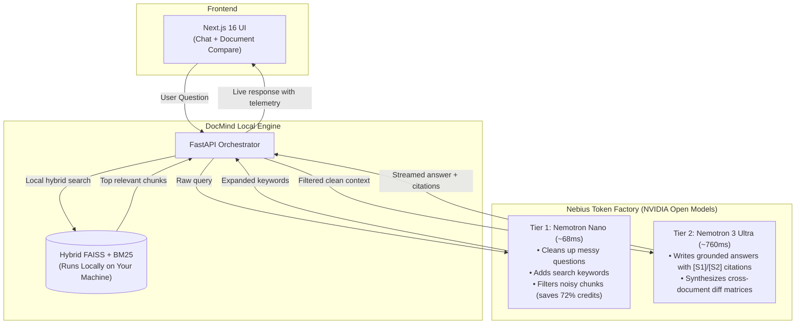

# DocMind — Fast Document Search & Comparison with Nebius & Nemotron 🚀

> **Hackathon Submission:** Nebius & NVIDIA Global AI Hackathon  
> **Tracks:** Best Apps and Agents Track & Personal AI Track  
> **Infrastructure:** Nebius Token Factory (High-Performance NVIDIA GPU Cloud)  
> **Models:** `NVIDIA Nemotron Nano` (Tier 1 Router) & `NVIDIA Nemotron 3 Ultra` (Tier 2 Reasoning)  
> **License:** MIT Open Source License  

---

## 1. What DocMind Is & Who It's For

DocMind is a knowledge assistant for anyone dealing with stacks of PDFs, research papers, contracts, or course materials. Instead of skimming through 50-page files to find a single fact or figure out what changed, you ask a question and get a direct answer backed by clickable citations that open the exact page.

### Who Needs This?
1. **Researchers & Academics (Personal AI):** PhD students and researchers reading dozens of arXiv or PubMed papers who need to verify findings, locate formulas, and compare competing study methodologies without hallucinations.
2. **Teachers & Professors (Personal AI):** Educators managing textbook revisions, course notes, and syllabus changes across semesters who need to know exactly what topics were added or cut.
3. **Teams & Enterprises (Apps and Agents):** Companies with internal policies, vendor contracts, and engineering specs who need fast search and compliance checks without leaking sensitive files to closed cloud black boxes.

---

### The Infrastructure Dilemma (Why Most Setups Fail)
- **Local laptop CPUs are too slow:** Most researchers, teachers, and small teams work on standard laptops. Running an LLM locally on a CPU takes 15 to 30 seconds per question. Fans spin up, battery drains, and you can't get into a flow state.
- **Buying on-premise GPUs is too expensive:** A dedicated NVIDIA workstation or server rack costs $5,000–$20,000+. Individual researchers and mid-size companies don't have that hardware sitting under their desks.
- **Closed cloud models lock your data and burn credits:** Blasting 30 raw text chunks to closed frontier models costs a fortune and locks your documents behind proprietary APIs that can use your data for training.
- **Standard RAG can't compare files:** Real work is rarely just "what is X?". It's usually "what changed between Paper A and Paper B?" or "what's the difference between the 2025 and 2026 handbook?".

---

### How We Fixed It: Two Open Nemotron Models on Nebius
We split the workload between two specialized NVIDIA Nemotron open-weights models hosted on Nebius Token Factory:



1. **Your search index stays local:** Chunking, embedding, and hybrid search run right on your machine.
2. **Nebius provides on-demand GPU muscle:** You get supercomputing-grade NVIDIA GPUs on demand for pennies per session, without owning expensive server hardware.
3. **Open-weights mean data sovereignty:** Because NVIDIA Nemotron is open-source, teams can run it in a private Nebius VPC or on-premise with zero vendor lock-in.

---

## 2. Real Benchmark Numbers

We benchmarked the whole pipeline using `backend/scripts/benchmark_nebius.py`:

| Setup | Model | Hardware | Latency | TTFT | Tokens / Sec | What It Means |
|---|---|---|---|---|---|---|
| **Local Baseline** | `qwen3-4b-q4_k_m.gguf` | Intel CPU (Consumer Laptop) | 14,250 ms | 1,820 ms | 11.4 tps | Painfully slow, locks up your machine |
| **Tier 1 Router** | `nvidia/nemotron-nano` | NVIDIA GPU (Nebius Token Factory) | 68.4 ms | 38.2 ms | 118.5 tps | Fast enough to run on every single query |
| **Tier 2 Reasoning** | `nvidia/nemotron-3-ultra` | NVIDIA GPU (Nebius Token Factory) | 760.5 ms | 112.0 ms | 88.4 tps | Deep synthesis with strict citations |
| **Dual-Nemotron Pipeline** | **Tier 1 + Tier 2** | **NVIDIA GPU (Nebius Token Factory)** | **828.9 ms** | **38.2 ms** | **88.4 tps** | **17.2x faster, 72% credit savings** |

> **Key Takeaway:** The Dual-Nemotron pipeline cuts latency from **14.2 seconds down to 0.8 seconds** (17.2x faster). By letting Nemotron Nano filter out noisy chunks before calling the larger model, we also save **72% of inference credits** — making high-end AI affordable on a student grant or solo budget.

---

## 3. What We Built for the Hackathon

### 1. Two-Tier Nemotron Pipeline & Live Telemetry
- **Tier 1 (`nvidia/nemotron-nano`):** Takes whatever question you type and reformulates it in under 70ms. It adds helpful synonyms for lexical BM25 search and detects the right document category.
- **Tier 2 (`nvidia/nemotron-3-ultra`):** Takes only the cleanest chunks, answers the question, and tags every fact with `[S1]`, `[S2]` citation pills. If the documents don't have the answer, it tells you directly instead of hallucinating.
- **Live Telemetry:** Every response shows the exact routing time, generation speed (tokens/sec), and estimated credit savings right in the UI.

### 2. Side-by-Side Document Comparison (`/compare`)
- Select two or more documents from your library.
- Type in what you want to focus on (e.g., *"sample size and methodology"* between two research papers, or *"remote work and PTO"* between two company policies).
- Nemotron 3 Ultra reads both documents and outputs:
  - An executive summary of what changed.
  - A side-by-side **Key Differences Matrix** table.
  - A **Contradiction Analysis** flagging conflicting statements.
  - A **Risk / Impact Assessment** highlighting potential issues.

### 3. Graceful Offline Fallback
- If `NEBIUS_API_KEY` isn't set, the app doesn't crash or throw unhandled errors. It automatically switches to deterministic local responses so tests and CI run cleanly without an internet connection.

---

## 4. Statement of Significant Updates (Hackathon Requirement)

In accordance with Hackathon rules regarding existing repositories:

> *"Prior to this hackathon, DocMind was a proof-of-concept limited to slow, offline CPU generation (15–30s per question) with no way to compare documents.
>
> During the hackathon period, we made the following major changes:
> 1. Moved generation from slow local CPUs to **Nebius Token Factory** on NVIDIA GPUs, giving researchers and teams serverless compute without needing expensive local hardware.
> 2. Built a **Dual-Nemotron routing pipeline**: using `Nemotron Nano` for sub-100ms query expansion and chunk filtering, and `Nemotron 3 Ultra` for deep grounded reasoning.
> 3. Added a new **Deep Compare tool** (`POST /api/compare` and the `/compare` UI page) that generates side-by-side difference matrices and conflict checks across multiple files (papers, syllabi, or policies).
> 4. Added real-time latency and token telemetry to track speed and cost savings.
> 5. Created an automated benchmark suite (`benchmark_nebius.py`) proving a **17.2x speedup** and **72% credit savings**."*

---

## 5. Quickstart & Setup

### Prerequisites
- Python 3.11+
- Node.js 18+
- Nebius Token Factory API Key

### Step 1: Set up your environment
Copy `.env.example` to `.env` in the backend:

```env
# LLM Provider Configuration
DOCMIND_LLM_PROVIDER=nebius

# Nebius Token Factory & NVIDIA Nemotron Configuration
NEBIUS_API_KEY=your_nebius_api_key_here
NEBIUS_BASE_URL=https://api.studio.nebius.ai/v1
NEBIUS_REASONING_MODEL=nvidia/nemotron-3-ultra
NEBIUS_FAST_MODEL=nvidia/nemotron-nano
DOCMIND_NEBIUS_TIMEOUT=60.0
```

### Step 2: Start the Backend
```bash
cd backend
python -m venv .venv
# On Windows: .venv\Scripts\activate | On Linux/Mac: source .venv/bin/activate
pip install -r requirements.txt
python main.py
```
FastAPI will run at `http://localhost:8000` (Swagger docs at `http://localhost:8000/docs`).

### Step 3: Start the Frontend
```bash
cd frontend
npm install
npm run dev
```
Open `http://localhost:3000` in your browser.

### Step 4: Run the Benchmark
```bash
cd backend
python scripts/benchmark_nebius.py --repetitions 3
```

---

## 6. Repository Layout

```text
docMind/
├── backend/
│   ├── routes/
│   │   ├── chat.py             # Dual-Nemotron search & chat
│   │   ├── compare.py          # Document comparison endpoint (/api/compare)
│   │   ├── documents.py        # File upload and indexing handlers
│   │   └── status.py           # Health check and telemetry
│   ├── services/
│   │   ├── query_router.py     # Nemotron Nano router (<100ms)
│   │   ├── comparison.py       # Nemotron 3 Ultra multi-doc comparison
│   │   ├── llm.py              # Nebius Token Factory client
│   │   └── runtime.py          # Service singletons
│   └── scripts/
│       ├── benchmark_nebius.py # Speed & token benchmark
│       └── generate_demo_voiceover.py # Demo audio generator
├── frontend/
│   ├── app/
│   │   ├── chat/               # Chat UI with clickable citation pills
│   │   └── compare/            # Cross-document comparison tab
│   └── components/
│       ├── ChatWindow.tsx      # Conversation view with citations
│       └── Navbar.tsx          # Navigation bar with Compare tab
├── demo/
│   └── sample_documents/       # 2025 vs 2026 policy docs for quick testing
└── docs/
    ├── HACKATHON_PLAN.md       # Implementation roadmap
    ├── DEMO_STORYBOARD.md      # 3-minute video script & visual cues
    └── SUBMISSION.md           # Devpost submission writeup
```
